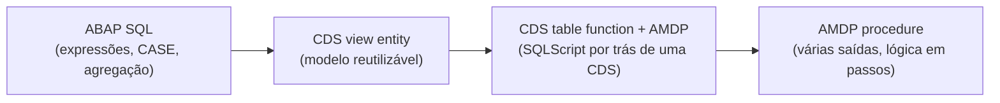
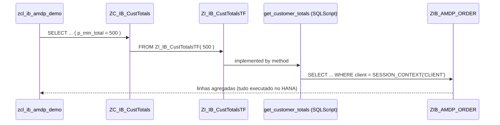

# AMDP - Study

> Nível: prática
> ABAP Managed Database Procedures: SQLScript escrito dentro de um método ABAP. Depende de [SAP-HANA-db-study](https://github.com/igor-barral/SAP-HANA-db-study) (SQLScript) e de [ABAP-SQL-db-study](https://github.com/igor-barral/ABAP-SQL-db-study) (code pushdown); a CDS que consome a table function antecipa [CDS-View-Entities-db-study](https://github.com/igor-barral/CDS-View-Entities-db-study).

## Objetivo

Escrever e ler uma classe AMDP, com uma **procedure** chamada do ABAP e uma **table function** consumida por uma CDS view entity, e saber quando esse nível de descida ao banco se justifica.

Ao concluir este estudo você deverá ser capaz de responder perguntas como:

- Quando o code pushdown do ABAP SQL não basta e é preciso AMDP?
- O que o ABAP Cloud permite em AMDP?
- O que a interface `IF_AMDP_MARKER_HDB` faz?
- Quais as regras de assinatura de um método AMDP?
- Qual a diferença entre `BY DATABASE PROCEDURE` e `BY DATABASE FUNCTION`?
- Para que serve a cláusula `USING`?
- Como o mandante (client) é tratado dentro de um AMDP?
- Como depurar e testar um AMDP?

## Ponte

| Você já conhece | No AMDP |
|---|---|
| Stored procedure versionada em migration (Laravel, Flyway, EF Migrations) | Procedure escrita num método ABAP, transportada e versionada como código ABAP |
| Chamar procedure via PDO/`DB::select('CALL ...')` | Chamar o método: `obj->get_top_customers( ... )` |
| Função Postgres `RETURNS TABLE` usada numa view | CDS table function implementada por AMDP e usada numa CDS view entity |
| Query builder vs SQL cru | ABAP SQL/CDS vs SQLScript |
| `tenant_id` filtrado manualmente em cada query | Mandante filtrado manualmente com `SESSION_CONTEXT('CLIENT')` |

A diferença importante para uma stored procedure comum: você **não** cria nada no banco. O servidor ABAP gera o objeto no HANA na primeira chamada, a partir do código do método, e o transporte leva o código ABAP, não o objeto do banco.

## Conteúdo

### 1. Onde o AMDP fica na escala de code pushdown



A regra da SAP é descer o mínimo necessário: ABAP SQL e CDS primeiro. AMDP entra quando a lógica precisa de algo que o ABAP SQL e o CDS não expressam, por exemplo:

- cálculo em vários passos com resultados intermediários grandes, que não se escreve bem numa única consulta;
- funções específicas do HANA que o ABAP SQL/CDS não expõem;
- lógica que hoje traz milhões de linhas para o servidor de aplicação só para agregá-las em `LOOP`.

Se uma CDS view entity resolve, fique nela: é portável entre as camadas do modelo de programação (RAP, Fiori Elements, OData), tem controle de acesso (DCL) e é verificada pelo compilador ABAP.

### 2. Anatomia de uma classe AMDP

Do repositório, [src/zcl_ib_amdp_ranking.clas.abap](src/zcl_ib_amdp_ranking.clas.abap):

```abap
CLASS zcl_ib_amdp_ranking DEFINITION PUBLIC FINAL CREATE PUBLIC.
  PUBLIC SECTION.
    INTERFACES if_amdp_marker_hdb.
    ...
    METHODS get_top_customers
      IMPORTING VALUE(iv_top)     TYPE i
      EXPORTING VALUE(et_ranking) TYPE tt_ranked_customer.
ENDCLASS.

CLASS zcl_ib_amdp_ranking IMPLEMENTATION.
  METHOD get_top_customers
    BY DATABASE PROCEDURE FOR HDB LANGUAGE SQLSCRIPT
    OPTIONS READ-ONLY
    USING zib_amdp_order.

    lt_totals = SELECT customer_id,
                       CAST( SUM(amount) AS DECIMAL(15,2) ) AS total_amount
                  FROM zib_amdp_order
                 WHERE client = SESSION_CONTEXT('CLIENT')
                 GROUP BY customer_id;
    ...
  ENDMETHOD.
ENDCLASS.
```

| Elemento | Papel |
|---|---|
| `INTERFACES if_amdp_marker_hdb` | Marca a classe como AMDP para HANA. Sem ela, `BY DATABASE ...` não compila. A interface não tem métodos. |
| `BY DATABASE PROCEDURE` | O método vira uma procedure no banco. |
| `BY DATABASE FUNCTION` | O método vira uma função; usado para implementar CDS table functions. |
| `FOR HDB LANGUAGE SQLSCRIPT` | Banco e linguagem (HANA, SQLScript). |
| `OPTIONS READ-ONLY` | Declara que o método só lê dados. |
| `USING zib_amdp_order` | Lista **todo** objeto ABAP (tabela, CDS, outro método AMDP) usado no corpo. Serve para o ABAP gerenciar dependências e gerar o acesso correto. |
| Corpo | SQLScript puro. Comentários com `--`; variáveis lidas com `:`. |

Regras de assinatura (confirme a lista completa na ABAP Keyword Documentation):

- todos os parâmetros por `VALUE(...)`;
- sem `RETURNING` em procedures; saídas por `EXPORTING` (ou `CHANGING`);
- tipos elementares ou tabelas internas cujas linhas têm apenas componentes elementares (sem estruturas aninhadas, sem referências);
- a classe pode ter métodos ABAP normais ao lado dos métodos AMDP.

### 3. Procedure vs table function

| | Procedure (`zcl_ib_amdp_ranking`) | Table function (`zcl_ib_amdp_customer_tf`) |
|---|---|---|
| Declaração | `METHODS ... IMPORTING VALUE(...) EXPORTING VALUE(...)` | `CLASS-METHODS m FOR TABLE FUNCTION zi_...` |
| Implementação | `BY DATABASE PROCEDURE` | `BY DATABASE FUNCTION` |
| Assinatura vem de | ABAP | Da definição CDS (`with parameters` e `returns`) |
| Quem chama | Código ABAP, como método | ABAP SQL/CDS, no `FROM` |
| Resultado | Parâmetros `EXPORTING` | `RETURN SELECT ...;` |
| Uso típico | Lógica pontual chamada por um serviço ABAP | Fonte de dados para CDS, RAP e Fiori |

### 4. Table function consumida por CDS

A definição fica em [src/zi_ib_custtotalstf.ddls.asddls](src/zi_ib_custtotalstf.ddls.asddls):

```cds
@ClientHandling.type: #CLIENT_DEPENDENT
@ClientHandling.algorithm: #SESSION_VARIABLE
define table function ZI_IB_CustTotalsTF
  with parameters
    p_min_total : abap.dec(15,2)
  returns
  {
    client       : abap.clnt;
    customer_id  : abap.char(10);
    order_count  : abap.int4;
    total_amount : abap.dec(15,2);
    last_order   : abap.dats;
  }
  implemented by method zcl_ib_amdp_customer_tf=>get_customer_totals;
```

A CDS view entity [src/zc_ib_custtotals.ddls.asddls](src/zc_ib_custtotals.ddls.asddls) usa a table function como fonte e acrescenta um campo calculado com `case`:

```cds
define view entity ZC_IB_CustTotals
  with parameters
    p_min_total : abap.dec(15,2)
  as select from ZI_IB_CustTotalsTF( p_min_total: $parameters.p_min_total )
{
  key customer_id,
      order_count,
      total_amount,
      last_order,
      case
        when total_amount >= 10000 then 'A'
        when total_amount >= 1000  then 'B'
        else 'C'
      end as customer_tier
}
```

E o ABAP consome a CDS com ABAP SQL, sem saber que há SQLScript embaixo ([src/zcl_ib_amdp_demo.clas.abap](src/zcl_ib_amdp_demo.clas.abap)):

```abap
SELECT FROM zc_ib_custtotals( p_min_total = 500 )
  FIELDS customer_id, order_count, total_amount, last_order, customer_tier
  ORDER BY total_amount DESCENDING
  INTO TABLE @DATA(totals).
```



### 5. Mandante (client) dentro do AMDP

No ABAP SQL o mandante é filtrado automaticamente. No SQLScript, **não**: o AMDP enxerga todas as linhas da tabela, de todos os mandantes. Por isso:

- a table function é declarada client-dependent, com o mandante como primeiro campo do `returns`;
- `@ClientHandling.algorithm: #SESSION_VARIABLE` indica que o filtro usa a variável de sessão;
- o corpo filtra com `WHERE client = SESSION_CONTEXT('CLIENT')`.

Esquecer esse filtro é um erro clássico que mistura dados de mandantes diferentes. Equivale a esquecer o `where tenant_id = ?` num sistema multi-tenant.

### 6. O que o ABAP Cloud permite em AMDP

No ABAP Cloud (BTP ABAP Environment e desenvolvimento cloud no S/4HANA), AMDP é permitido, com restrições. Os pontos que se pode afirmar com segurança:

- só `FOR HDB LANGUAGE SQLSCRIPT` (o HANA é o único banco);
- os objetos acessados no corpo e listados em `USING` precisam obedecer às regras de acesso do ABAP Cloud; tabelas e CDS do próprio componente de software são o caso comum, como neste repositório;
- não se acessa objeto do banco que o ABAP não conheça (schemas nativos, tabelas criadas direto no HANA).

A lista exata do que é permitido (por exemplo, quais objetos SAP liberados podem aparecer em `USING`) muda entre versões: confirme na ABAP Keyword Documentation do seu sistema, seção de AMDP em ABAP for Cloud Development. Esse é um bom tema para validar na prática, no trial, antes de afirmar numa entrevista.

### 7. Depuração e testes

- **Depuração**: o ADT tem depurador de AMDP; os breakpoints são colocados no corpo SQLScript e a sessão de depuração é específica para o banco. Confirme o procedimento na sua versão do ADT.
- **Testes**: um AMDP consumido por CDS pode ser testado com o CDS Test Double Framework, que substitui as fontes de dados por dados de teste. Ver [ABAP-Unit-softwarearchitecture-study](https://github.com/igor-barral/ABAP-Unit-softwarearchitecture-study).
- **Mantenha o AMDP fino**: regra de negócio complexa em SQLScript é difícil de testar e de ler. Coloque no AMDP só o que precisa estar no banco.

### 8. Objetos do repositório

| Objeto | Tipo | Papel |
|---|---|---|
| `ZIB_AMDP_ORDER` | Tabela transparente | Pedidos de estudo (cliente, data, valor) |
| `ZCL_IB_AMDP_RANKING` | Classe AMDP | Procedure: ranking dos N maiores clientes com `RANK() OVER` |
| `ZCL_IB_AMDP_CUSTOMER_TF` | Classe AMDP | Implementação da table function (`BY DATABASE FUNCTION`) |
| `ZI_IB_CustTotalsTF` | CDS table function | Totais por cliente, com parâmetro de valor mínimo |
| `ZC_IB_CustTotals` | CDS view entity | Consome a table function e classifica o cliente em faixas A, B, C |
| `ZCL_IB_AMDP_DEMO` | Classe executável | Popula a tabela, chama a procedure e lê a CDS |

## Respostas

**Quando o code pushdown do ABAP SQL não basta e é preciso AMDP?**
Quando a lógica exige vários passos com resultados intermediários, funções do HANA que o ABAP SQL/CDS não oferecem, ou quando a alternativa seria trazer grandes volumes ao servidor de aplicação. Se ABAP SQL ou CDS resolvem, eles são preferíveis: são mais simples, portáveis entre camadas e têm controle de acesso nativo.

**O que o ABAP Cloud permite em AMDP?**
AMDP para HANA em SQLScript, acessando objetos permitidos pelas regras do ABAP Cloud (tipicamente tabelas e CDS do próprio componente de software), sempre declarados em `USING`. Não permite acessar objetos nativos do banco desconhecidos pelo ABAP. Os detalhes de quais objetos liberados podem ser usados devem ser confirmados na documentação da versão.

**O que a interface `IF_AMDP_MARKER_HDB` faz?**
Nada em tempo de execução: é uma interface marcadora, sem métodos, que autoriza a classe a ter métodos implementados `BY DATABASE ... FOR HDB`.

**Quais as regras de assinatura de um método AMDP?**
Parâmetros por valor, sem `RETURNING` em procedures, apenas tipos elementares ou tabelas de linhas elementares. Em table functions, a assinatura vem da CDS e o método é `CLASS-METHODS ... FOR TABLE FUNCTION`.

**Qual a diferença entre `BY DATABASE PROCEDURE` e `BY DATABASE FUNCTION`?**
A procedure é chamada como método ABAP e devolve dados por parâmetros `EXPORTING`. A function implementa uma CDS table function e devolve um único resultado com `RETURN SELECT`, consumido no `FROM` de consultas.

**Para que serve a cláusula `USING`?**
Declara os objetos ABAP usados no SQLScript. O ABAP usa essa lista para gerenciar dependências, gerar os objetos corretos no banco e verificar permissões. Objeto usado e não declarado gera erro de sintaxe.

**Como o mandante é tratado dentro de um AMDP?**
Manualmente. O SQLScript não filtra mandante; o código deve filtrar com `SESSION_CONTEXT('CLIENT')` e, na table function, declarar o tratamento de mandante com `@ClientHandling`.

**Como depurar e testar um AMDP?**
Com o depurador de AMDP do ADT e, para testes automatizados, com o CDS Test Double Framework sobre a CDS que consome a table function. Manter o AMDP pequeno reduz a necessidade de ambos.

## Como rodar

### 1. Verificação local (sem sistema SAP)

```bash
docker compose run --rm abaplint
docker compose down
```

O abaplint verifica sintaxe ABAP, tipos, campos da tabela `ZIB_AMDP_ORDER` e os campos lidos das CDS. Resultado esperado: `abaplint: 0 issue(s) found`.

Limitação: o abaplint **não** analisa o SQLScript dentro dos métodos AMDP; ele trata o corpo como texto. Erros de SQLScript só aparecem na ativação no sistema. As classes SAP que não estão no pacote de dependências do abaplint (`abaplint/deps`) não têm assinatura verificada.

### 2. Execução real

1. Importe o repositório com abapGit num sistema com HANA (SAP BTP ABAP Environment trial ou ABAP Platform Trial), no pacote `ZIB_AMDP`.
2. Ative todos os objetos (tabela primeiro, depois classes AMDP, depois as CDS).
3. Abra `ZCL_IB_AMDP_DEMO` no ADT e execute com **F9** (Run As ABAP Application (Console)).
4. Resultado esperado: o top 2 clientes (`C001` e `C002`) e a lista de clientes com total acima de 500 com a faixa calculada.

## Referências

- ABAP Keyword Documentation, https://help.sap.com (buscar por "AMDP - ABAP Managed Database Procedures" e "CDS table functions")
- SAP Help Portal, https://help.sap.com (buscar por "SAP HANA SQLScript Reference")
- SAP Learning, https://learning.sap.com (buscar por "ABAP Managed Database Procedures")
- SAP Community, https://community.sap.com (buscar por "AMDP table function")
- abaplint, https://abaplint.org
- abapGit, https://abapgit.org
